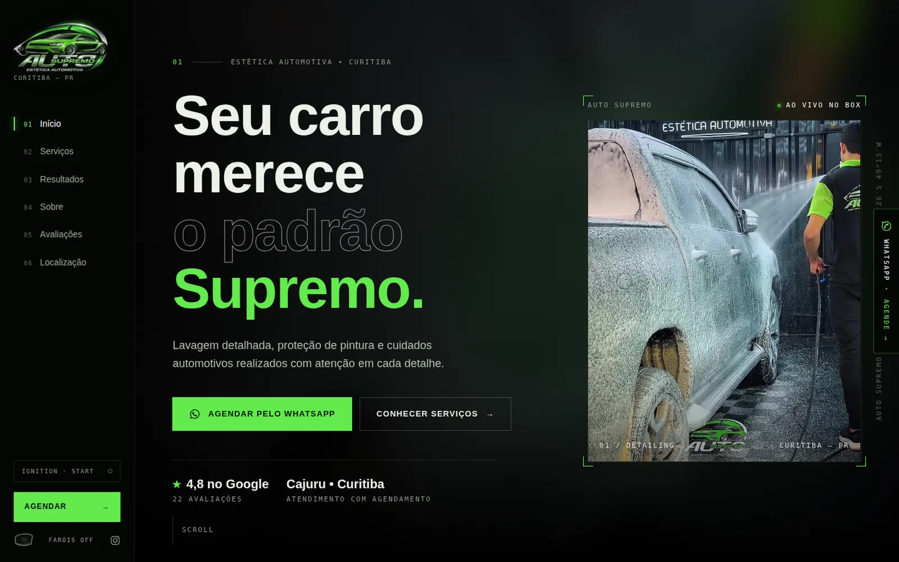

<p align="center">
  
</p>

<p align="center">
  
  
  
  
</p>

<p align="center">
  Demo de site para uma estética automotiva real de Curitiba, com experiência interativa de abertura, fichas de serviço, comparador antes/depois e agendamento pelo WhatsApp.
</p>

<p align="center">
  <a href="https://lorenzo-or7.github.io/auto-supremo-demo/"><b>🔗 Acessar o site</b></a>
</p>

---

## 🖥️ Preview

<p align="center">
  <a href="https://lorenzo-or7.github.io/auto-supremo-demo/"></a>
</p>

---

## 📌 Sobre o projeto

Estética automotiva é um serviço que se vende pelo resultado visual. A proposta foi criar um site com clima de carro de luxo: preto, verde neon, vídeos do box e um comparador que deixa o cliente ver o antes e depois com as próprias mãos.

Preto absoluto com o **verde neon** da marca, tipografia larga e detalhes técnicos em fonte mono, como num painel de carro.

---

## ✨ Funcionalidades

- 🔑 Experiência interativa "Supremo Ignition" com botão start/stop
- 📋 Serviços com ficha técnica de cada cuidado
- ↔️ Comparador antes/depois com janela de arrastar
- 🎬 Vídeos do processo no box
- 4️⃣ Como funciona em 4 passos
- 🖼️ Galeria e avaliações de clientes
- 💡 Tema claro/escuro no botão de faróis
- 📍 Localização com mapa e agendamento pelo WhatsApp
- 📱 Layout responsivo

---

## 🛠️ Tecnologias

- **HTML5** para a estrutura
- **CSS3** para identidade visual, responsividade e animações
- **JavaScript** puro para as interações
- **GitHub Pages** para hospedagem

Site completo em um único arquivo HTML, com imagens em WebP e vídeos locais.

---

## ⚙️ Como rodar

Não precisa instalar nada: baixe o repositório e abra o arquivo `index.html` no navegador.

```bash
git clone https://github.com/lorenzo-or7/auto-supremo-demo.git
```

> Este é um projeto demonstrativo, criado para apresentar a proposta ao estabelecimento.

---

## 👨‍💻 Autor

<p>
  Feito por <b>Lorenzo Orsetti</b><br/>
  <a href="https://lorenzo-or7.github.io">
    
  </a>
  <a href="https://www.linkedin.com/in/lorenzo-orsetti-031906349/">
    
  </a>
  <a href="https://github.com/lorenzo-or7">
    
  </a>
</p>

<p align="center">
  
</p>
